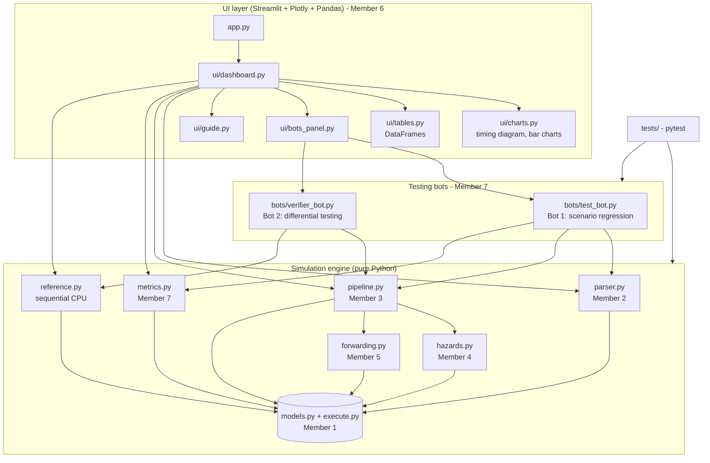

# Software Architecture

The project has three layers. Each layer only depends on the layer below it, so seven people can work in parallel.



## Data flow

1. The student types assembly text in the dashboard.
2. `parser.parse_program` returns `Instruction` objects (or line-numbered errors).
3. `PipelineSimulator.run` simulates the program cycle by cycle and returns a `SimulationResult`
   (cycle snapshots, per-instruction stage history, events, final registers and memory).
4. `metrics.compute_metrics` turns the result into CPI, speedup, utilization, ...
5. `ui/` turns the result into the timing diagram, tables and charts. **The UI never calculates anything about the pipeline itself.**

## Inside one clock cycle (`pipeline.py`)

```
WB  -> write register file (first half of the cycle)
EX  -> ALU / address / branch condition (forwarding resolved here)
MEM -> data memory read or write
ID  -> hazard check (hazards.detect_data_stall)  -> stall or read operands
CTL -> taken branch / jump?  -> redirect fetch, flush wrong-path instructions
SHIFT + FETCH -> every instruction moves one stage, IF fetches the next one
```

## Module contracts (what each member must keep stable)

| Module | Public functions / classes | Used by |
|---|---|---|
| `models.py` | `Instruction`, `DynamicInstruction`, `PipelineConfig`, `SimulationResult`, `STAGES` | everyone |
| `parser.py` | `parse_program(text) -> ParseResult`, `parse_register_values`, `parse_memory_values` | UI, bots |
| `pipeline.py` | `PipelineSimulator(config).run(program, regs, memory) -> SimulationResult` | UI, bots, metrics |
| `hazards.py` | `detect_data_stall(...)`, `find_raw_hazards(...)`, `find_control_instructions(...)` | pipeline, UI |
| `forwarding.py` | `find_forwarding_source(register, mem_slot, wb_slot)` | pipeline |
| `metrics.py` | `compute_metrics(result) -> PerformanceMetrics` | UI, bots |
| `reference.py` | `run_reference(program, regs, memory)` | verifier bot, UI |

## Key design decisions

* **Simulation and UI are separate**, so the engine can be tested without a browser.
* **Pipeline history is recorded once** and replayed by the UI, so stepping backwards is free.
* **Stalls are real**: IF and ID are held and a bubble enters EX, exactly like hardware.
* **One ALU for both CPUs** (`execute.py`): the verifier bot then tests only the timing machinery.
